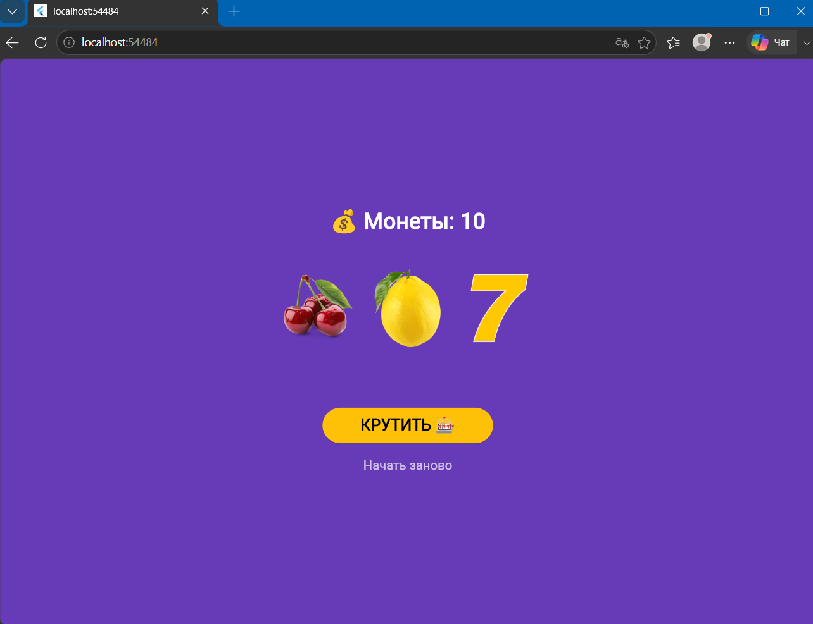
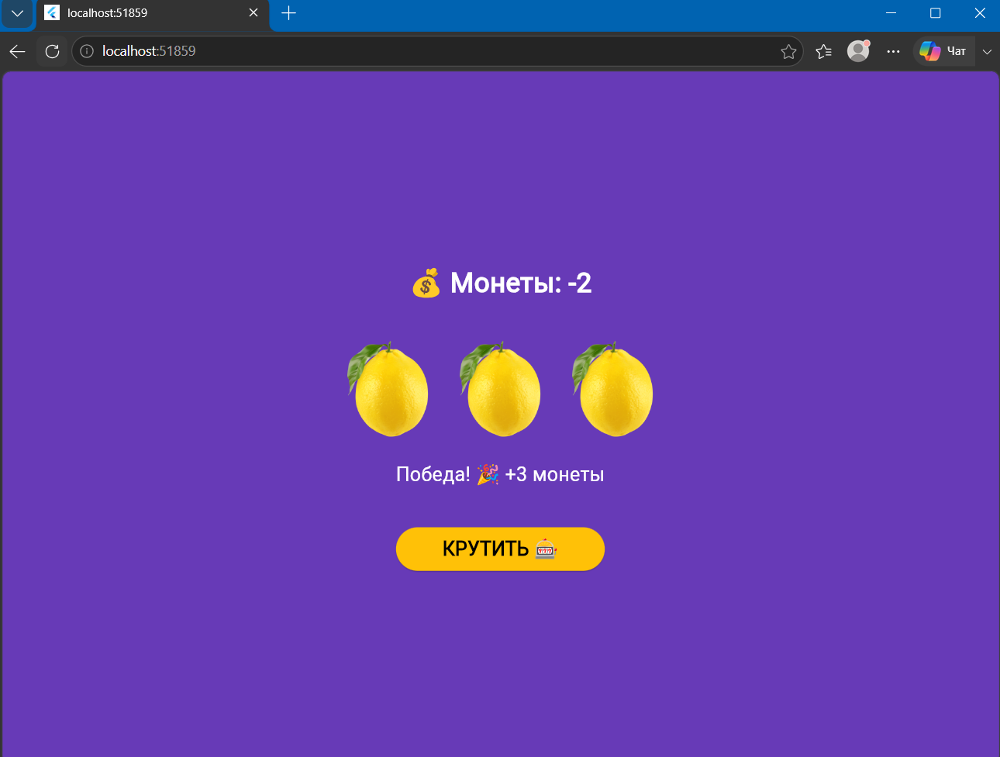
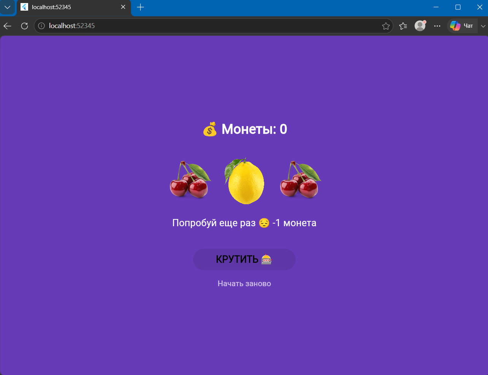
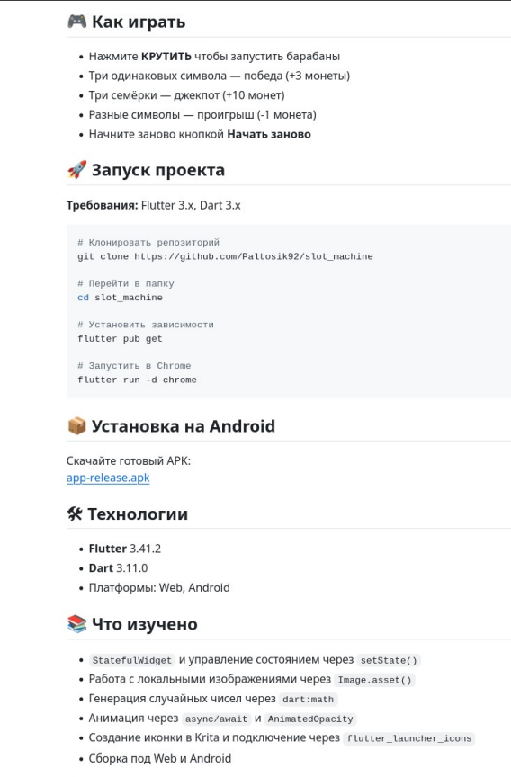

# Flutter. Лабораторная работа №9 - 10.
**Корначев Кирилл**
**Группа: ИСП-243**
**Дата сдачи:**
# Что изучили
- изучили разницу между `StatelessWidget` и `StatefulWidget`
- научились пользоваться состоянием приложением через `setState()`
- подключать локальные изображения и обрабатывать нажатия кнопок — слот-машины.

## Инструкция по запуску
1) `git clone <репозиторий ссылка>`
2) `cd <папка проекта>`
3) `flutter pub get` *(скачать все необходимые в `pubspec.yaml`)*
4) `flutter run -d chrome` *(ваш браузер)*
# Лабораторная работа №10. Слот-машина
Автор: Фамилия Имя. Группа: ваша группа. Дата: дата сдачи.
| Главный экран | Результат |
| --- | --- |
|  |  | 
- Запуск: `flutter pub get`, затем `flutter run -d chrome` или `flutter run -d
ID_устройства`.
- Звук включается отдельной кнопкой; до её нажатия приложение молчит.
- Сборка Android: `flutter build apk --release`.
- Готовый файл: `build/app/outputs/flutter-apk/app-release.apk`.
- APK: ссылка на файл собственного GitHub Release.
- Проверенные Flutter/Dart: фактический вывод `flutter --version`.
- Изучено: состояние и анимация; локальные ресурсы; аудиофокус; жизненный цикл и
освобождение плееров; иконки; Web и Android release-сборки.

