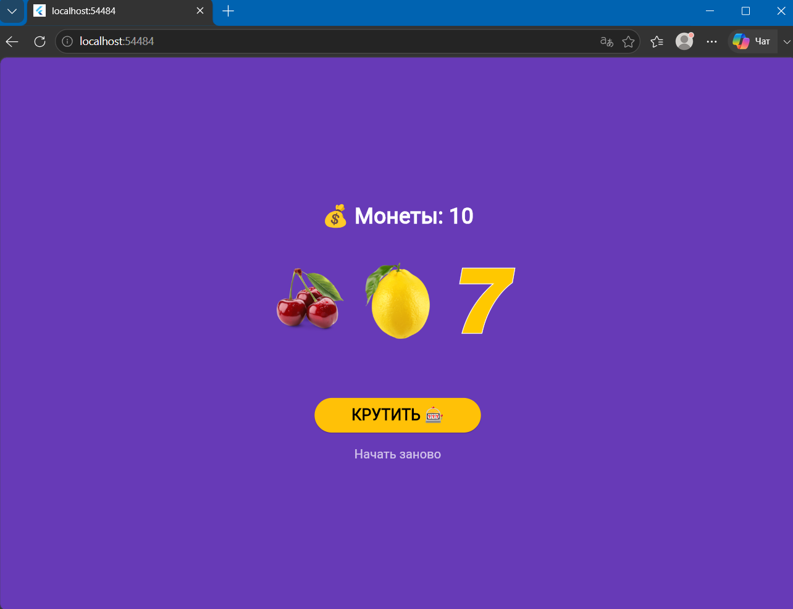

# Flutter. Лабораторная работа №9 - 10.
**Корначев Кирилл**
**Группа: ИСП-243**
**Дата сдачи:**
# Что изучили
- изучили разницу между `StatelessWidget` и `StatefulWidget`
- научились пользоваться состоянием приложением через `setState()`
- подключать локальные изображения и обрабатывать нажатия кнопок — слот-машины.

## Инструкция по запуску
1) `git clone <репозиторий ссылка>`
2) `cd <папка проекта>`
3) `flutter pub get` *(скачать все необходимые в `pubspec.yaml`)*
4) `flutter run -d chrome` *(ваш браузер)*
